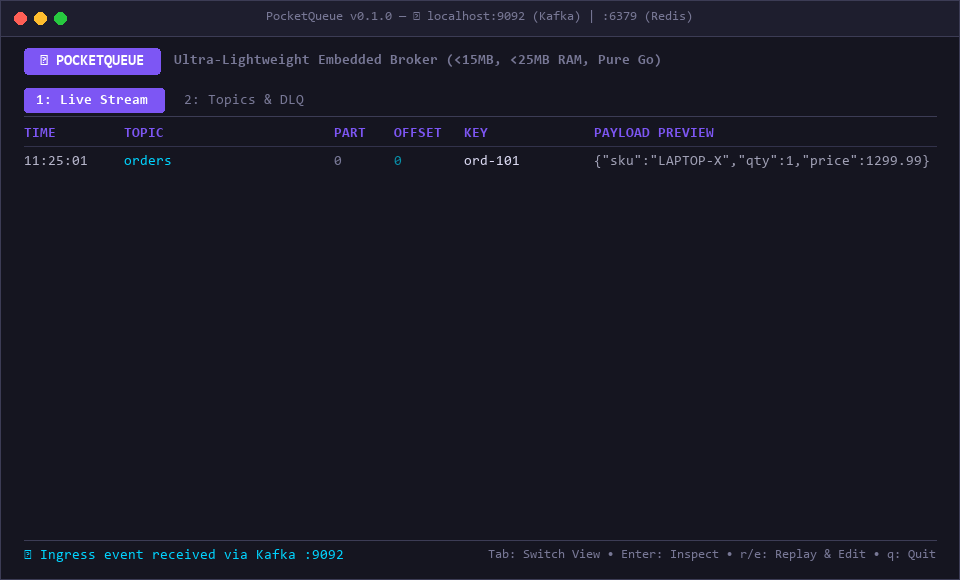

# ⚡ PocketQueue

> **The SQLite of Message Brokers.**  
> Ultra-lightweight (<5 MB single binary, <8 MB RAM), zero-dependency local message broker with an interactive Terminal UI (TUI), speaking drop-in **Kafka Wire Protocol** (`:9092`), **Redis Streams RESP** (`:6379`), and **MQTT v3.1.1** (`:1883`).

[](https://goreportcard.com/report/github.com/pandusatrianura/pocketqueue)
[](LICENSE)
[](scripts/audit.ps1)
[](scripts/audit.ps1)
[](scripts/audit.ps1)

<p align="center">
  
</p>
<p align="center">
  <em>⚡ <strong>PocketQueue in action:</strong> Live Kafka & Redis Streams event streaming, JSON Payload Inspector, and in-terminal Dead-Letter Queue (DLQ) Replay Studio.</em>
</p>

---

## 💡 Why PocketQueue?

Running Kafka, Zookeeper, or RabbitMQ on local dev machines consumes **1.5–3 GB of RAM**, burns CPU, drains battery, and requires complex Docker Compose setups just to test simple event-driven microservices.

**PocketQueue solves this with a 10x simpler model:**
- **Single executable binary (< 5 MB)**: No JVM, no Docker, no Erlang runtime, zero external dependencies (`CGO_ENABLED=0`).
- **Sub-8 MB RAM Footprint**: Run it in the background or right in your terminal with zero memory guilt.
- **Microsecond Cold Start (< 3 ms)**: Ready to accept connections almost instantaneously.
- **Drop-in Wire Compatibility**: Works with standard Kafka SDKs (port `9092`), Redis Streams clients (port `6379`), and MQTT v3.1.1 IoT devices (port `1883`) without modifying your business code.
- **Interactive Terminal UI (TUI) & Embedded Web Dashboard**: Real-time event streaming, syntax-highlighted JSON inspector, and inline **Dead-Letter Queue (DLQ) Replay Studio** powered by Charm `bubbletea`, plus a zero-dependency embedded Web UI at `http://localhost:8080`.
- **Dynamic Protobuf & Schema Decoder**: Automatic detection of Confluent Wire Format (magic byte `0x00` + Schema ID) and raw Protobuf payloads via `--proto-desc`, with structured JSON reflection and aligned 16-byte Hex Dump fallback.
- **Flexible Durability**: Runs in pure memory by default (zero disk cruft) or with persistent append-only Write-Ahead Logs via `--data-dir`.

---

## 📊 Benchmark & Comparison

| Metric / Feature | Kafka (Docker / KRaft) | Redpanda (Docker) | RabbitMQ | **PocketQueue** |
|---|---|---|---|---|
| **Memory (Idle)** | 1,200 – 2,000 MB | 500 – 1,000 MB | 250 – 500 MB | **< 8 MB** ⚡ |
| **Startup Latency** | 30 – 60 seconds | 5 – 10 seconds | 10 – 20 seconds | **~2 milliseconds** 🚀 |
| **Binary / Image Size** | > 800 MB (JVM + Image) | > 250 MB | > 300 MB | **< 5 MB** (Single Binary) |
| **External Dependencies** | Docker, JVM, KRaft | Docker, C++ runtimes | Docker, Erlang VM | **None** (Pure Go) |
| **Built-in TUI & Inspector** | ❌ (Requires AKHQ/Kafka UI) | ❌ (Requires Redpanda Console) | ❌ (Web UI only) | **✅ Native TUI & Web UI** |
| **In-Terminal DLQ Replay** | ❌ | ❌ | ❌ | **✅ Built-in (`r`/`e`)** |
| **Triple Wire Protocol** | Kafka only | Kafka only | AMQP / MQTT | **✅ Kafka + Redis + MQTT** |

---

## 🚀 Quick Start

### 1. Installation

#### Homebrew (macOS / Linux):
```bash
brew install pandusatrianura/tap/pocketqueue
```

#### Scoop (Windows):
```powershell
scoop bucket add pocketqueue https://github.com/pandusatrianura/pocketqueue
scoop install pocketqueue
```

#### Docker (< 8 MB Ultra-Minimal Scratch Image):
```bash
docker run -d -p 9092:9092 -p 6379:6379 ghcr.io/pandusatrianura/pocketqueue:latest
```

#### Docker Compose (Drop-In Microservices Replacement):
Download or reference [`docker-compose.example.yml`](docker-compose.example.yml):
```yaml
services:
  pocketqueue:
    image: ghcr.io/pandusatrianura/pocketqueue:latest
    ports:
      - "9092:9092" # Kafka wire protocol
      - "6379:6379" # Redis Streams wire protocol
```

#### Build from source:
```bash
git clone https://github.com/pandusatrianura/pocketqueue.git
cd pocketqueue
go build -ldflags="-s -w" -o bin/pocketqueue ./cmd/pocketqueue
```

### 2. Launch with Interactive TUI (Default)
Run PocketQueue directly in your terminal:
```bash
./bin/pocketqueue
```
*To launch with live simulated demo events streaming right away:*
```bash
./bin/pocketqueue --demo
```

### 3. Launch in Headless Daemon Mode (CI / Background)
```bash
./bin/pocketqueue --headless --port 9092 --redis-port 6379
```

---

## 📖 How to Use PocketQueue

### Workflow 1: Inner-Loop Development & Real-Time Inspection
1. **Start PocketQueue** in a dedicated terminal pane:
   ```bash
   ./bin/pocketqueue
   ```
2. **Point your application** to `localhost:9092` (Kafka) or `localhost:6379` (Redis):
   ```bash
   export KAFKA_BROKERS="localhost:9092"
   go run ./cmd/order-service
   ```
3. Events will stream into the **Live Stream** table in real time showing timestamp, topic name, partition, monotonic offset, key, and payload preview.
4. Press `Enter` to open the **Payload Inspector** and view formatted JSON, headers, and metadata.

### Workflow 2: Dead-Letter Queue (DLQ) Triage & Replay Studio
When a downstream consumer fails or a message is routed to DLQ:
1. In the TUI, navigate to the failed record marked with `🚨 <topic>.dlq`.
2. Press `r` or `e` to open the **Replay Studio**.
3. Fix the JSON payload directly inside the terminal (e.g. fix an invalid SKU or status field).
4. Press `Ctrl+S`: PocketQueue immediately republishes the repaired message back into the target topic, triggering your consumer again without having to restart your whole workflow.

### Workflow 3: Ad-Hoc CLI Publishing (No Client Code Needed)
Send mock events or trigger workers directly from your command line:
```bash
# Publish a JSON event to a topic
./bin/pocketqueue -topic orders -key ord-101 -value '{"customer": "diana", "amount": 149.99}'

# Target a custom broker port
./bin/pocketqueue -broker 127.0.0.1:9092 -topic notifications -value '{"alert": "high_cpu"}'
```

### Workflow 4: Dual-Protocol Interoperability
PocketQueue allows Kafka and Redis clients to communicate through the same broker:
- Microservice A publishes to Redis Streams via `redis-cli XADD orders * item "keyboard"`
- Microservice B consumes from Kafka topic `orders` at `localhost:9092`
- All events appear unified inside the same PocketQueue TUI!

### Workflow 5: HTTP REST Ingress & Server-Sent Events (SSE) Stream
Bridge web applications (React, Vue, Svelte, or mobile web) without requiring Kafka or Redis client libraries:

1. **Start PocketQueue with HTTP Bridge**:
   ```bash
   ./bin/pocketqueue --http-port 8080
   ```

2. **Publish via cURL / REST API**:
   ```bash
   curl -X POST http://localhost:8080/api/v1/topics/chat \
     -H "Content-Type: application/json" \
     -d '{"key": "user-42", "value": {"message": "Hello from browser!"}}'
   ```

3. **Stream Events via Native Browser `EventSource`**:
   ```javascript
   const eventSource = new EventSource("http://localhost:8080/api/v1/topics/chat/sse");

   eventSource.onmessage = (event) => {
     const data = JSON.parse(event.data);
     console.log("Real-time event received:", data.key, data.value);
   };
   ```

### Workflow 6: Dead-Letter Queue (DLQ) Webhook Dispatcher
Automatically forward dead-letter messages to an external incident response or notification service:
```bash
./bin/pocketqueue --dlq-webhook-url http://alertmanager.local/api/v1/alerts
```
When any message fails processing and is routed to a `.dlq` topic, PocketQueue's non-blocking background dispatcher sends an HTTP POST with custom headers (`x-dlq-original-topic`, `x-dlq-reason`) and up to 2 retries without stalling broker throughput.

### Workflow 7: Zero-Dependency Embedded Web Dashboard
Launch PocketQueue with `--http-port 8080` to access the built-in Web Studio directly in your browser (`http://localhost:8080` or `http://localhost:8080/ui`):

```bash
# Start PocketQueue with Web Dashboard & realistic demo traffic
./bin/pocketqueue --http-port 8080 --demo
```

#### Web Dashboard Highlights:
- ⚡ **Live Event Stream**: Real-time cross-topic event ingestion via Server-Sent Events (`/api/v1/topics/_all/sse`), live text search, topic dropdown filter, auto-scroll pause/freeze, and click-to-inspect JSON payload modal.
- 📈 **Native HTML5 Canvas 2D Throughput Sparkline**: Moving message throughput chart (events/sec over a sliding 30-second window) calculated and rendered natively with zero external chart libraries.
- 📊 **Topics & Watermarks Directory**: Real-time partition counts, earliest and latest high-watermark offsets, and system telemetry (uptime, memory allocation, active goroutines).
- 📤 **Web Message Publisher**: Built-in visual publisher to send JSON or plain text payloads directly into any topic and partition with custom headers without opening cURL or an external terminal.
- 🚨 **Dead-Letter Queue (DLQ) Studio & 1-Click Replay**: Dedicated triage dashboard for `.dlq` topics. Inspect poison pill failure reasons, edit/repair the payload in a modal, and re-inject the corrected event directly into the target topic via `POST /api/v1/dlq/replay`.
- 🔒 **Air-Gapped & Zero-Dependency**: Embedded directly into the single executable via Go `embed.FS` (total asset bundle $< 31\text{ KB}$ uncompressed, PicoCSS v2 subset, vanilla JS, SVG icons). Zero external CDN or Node.js runtime required; works 100% offline.

### Workflow 8: Dynamic Protobuf & Confluent Wire Format Payload Decoder
In modern event-driven architectures, messages are frequently serialized using Protocol Buffers or Confluent Schema Registry wire format (magic byte `0x00` + 4-byte Schema ID + varint indexes) rather than plain text JSON.

PocketQueue features an auto-detecting dynamic decoding cascade:
1. **Confluent Wire Format Auto-Detection**: Detects magic byte `0x00` and extracts the 4-byte Schema ID. When a descriptor set is provided via `--proto-desc`, PocketQueue automatically unmarshals and renders the Protobuf message into formatted JSON.
2. **Raw Protobuf Auto-Detection**: Unmarshals raw binary Protobuf messages by dynamically reflecting schemas across all registered definitions in the descriptor set.
3. **Aligned 16-Byte Hex Dump Fallback**: Any binary payload without a matching descriptor or unrecognized bytes automatically renders in standard 16-byte aligned hex format with ASCII preview (like `hexdump -C`).
4. **Visual Badges**: Displays `[Protobuf: <MessageType> (#<ID>)]`, `[Confluent Wire Format (#<ID>)]`, or `[Binary - <N> bytes]` pills directly in the Charm TUI Inspector (`Enter`) and Web Dashboard Modal.
5. **Enriched SSE Streams**: Delivers a `decoded` object (`kind`, `schema_id`, `message_name`, `formatted`, `is_binary`) in the real-time event stream (`/api/v1/topics/_all/sse`).

```bash
# 1. Compile your .proto files into a descriptor set:
protoc --descriptor_set_out=schemas.desc --include_imports order.proto user.proto

# 2. Launch PocketQueue with dynamic Protobuf decoding enabled:
./bin/pocketqueue --proto-desc schemas.desc --http-port 8080
```

### Workflow 9: MQTT v3.1.1 IoT Protocol Ingress Bridge
In Internet of Things (IoT), robotics, and embedded development, hardware devices (ESP32, Raspberry Pi, Arduino, sensors) send telemetry using lightweight MQTT control packets rather than heavy HTTP or Kafka connections.

PocketQueue natively listens on port `1883` (`--mqtt-port 1883`) as a drop-in MQTT v3.1.1 broker with **bi-directional cross-protocol bridging**:
- **IoT Ingress**: An edge sensor publishes telemetry via MQTT $\to$ instantly accessible by Kafka microservices (`:9092`), Redis Streams (`:6379`), and the Web Dashboard SSE stream (`:8080`).
- **IoT Egress**: Microservices producing to Kafka or Redis topics $\to$ automatically fanned out in real-time to MQTT devices subscribed to matching topics or wildcards (`+` and `#`).
- **Zero Configuration**: Built-in support for QoS 0, QoS 1 (`PUBACK`), `PINGREQ` keepalive, and graceful clean sessions.

```bash
# 1. Publish sensor data from an edge device or terminal:
mosquitto_pub -h 127.0.0.1 -p 1883 -t "factory/chiller1/temp" -m '{"temp_c": 18.4, "status": "nominal"}'

# 2. Subscribe to all factory sensors using MQTT multi-level wildcard:
mosquitto_sub -h 127.0.0.1 -p 1883 -t "factory/#" -v

# 3. Or consume the exact same sensor stream using Kafka or the Web Dashboard!
```

---

## 🔌 Verified Client SDK Compatibility

PocketQueue is continuously tested against official production client libraries to guarantee drop-in compatibility with real microservices:

| Ecosystem | Client Library | Protocol | Tested Capabilities | Status |
|---|---|---|---|:---:|
| **Go** | [`IBM/sarama`](https://github.com/IBM/sarama) | Kafka `:9092` | `SyncProducer`, `Consumer`, `ConsumerGroup`, RecordBatch v2 | ✅ Verified |
| **Go** | [`redis/go-redis/v9`](https://github.com/redis/go-redis/v9) | Redis Streams `:6379` | `Ping`, `XAdd`, `XLen`, `XRange`, `XRead` (with `Block`) | ✅ Verified |
| **Python** | [`redis-py`](https://github.com/redis/redis-py) | Redis Streams `:6379` | `xadd`, `xlen`, `xrange`, `xgroup_create`, `xreadgroup`, `xack`, `xrevrange`, `xdel` | ✅ Verified |
| **Python** | Standard Library Socket | Kafka `:9092` | `ApiVersions`, `Metadata`, `CreateTopics` (API 19), `DeleteTopics` (API 20) | ✅ Verified |
| **Node.js** | [`ioredis`](https://github.com/redis/ioredis) | Redis Streams `:6379` | `xadd`, `xlen`, `xrange`, `xgroup`, `xreadgroup`, `xack`, `xrevrange`, `xdel` | ✅ Verified |
| **Node.js** | Standard `net` Socket | Kafka `:9092` | `ApiVersions`, `Metadata`, `CreateTopics` (API 19), `DeleteTopics` (API 20) | ✅ Verified |
| **CLI / IoT** | [`mosquitto_pub` / `_sub`](https://mosquitto.org/) | MQTT `:1883` | `CONNECT`, `PUBLISH` (QoS 0/1), `SUBSCRIBE` (wildcards `+`, `#`), `PINGREQ` | ✅ Verified |
| **Python** | [`paho-mqtt`](https://pypi.org/project/paho-mqtt/) | MQTT `:1883` | Client connect, keepalive ping, QoS 0/1 publish, subscribe | ✅ Verified |
| **Node.js** | [`mqtt.js`](https://github.com/mqttjs/MQTT.js) | MQTT `:1883` | Client connect, QoS 0/1 publish, wildcard subscribe | ✅ Verified |

#### Go Example: Producing & Consuming with `IBM/sarama`
```go
config := sarama.NewConfig()
config.Version = sarama.V2_1_0_0
config.Producer.Return.Successes = true

producer, _ := sarama.NewSyncProducer([]string{"127.0.0.1:9092"}, config)
defer producer.Close()

// Publish message
producer.SendMessage(&sarama.ProducerMessage{
    Topic: "orders",
    Key:   sarama.StringEncoder("ord-001"),
    Value: sarama.StringEncoder(`{"status": "paid"}`),
})
```

#### Go Example: Appending & Blocking Read with `go-redis`
```go
rdb := redis.NewClient(&redis.Options{Addr: "127.0.0.1:6379"})
defer rdb.Close()

// Append to stream
rdb.XAdd(ctx, &redis.XAddArgs{
    Stream: "telemetry",
    Values: map[string]interface{}{"temp": "24.5"},
})

// Blocking read
entries, _ := rdb.XRead(ctx, &redis.XReadArgs{
    Streams: []string{"telemetry", "$"},
    Block:   5 * time.Second,
}).Result()
```

---

## ⚙️ How to Configure for Running Well

PocketQueue requires zero configuration by default, but provides fine-grained controls for different environments.

### CLI Flag Reference

| Flag | Default | Description | Recommended Usage |
|---|---|---|---|
| `--host` | `127.0.0.1` | Binding network host | Use `127.0.0.1` for local safety; use `0.0.0.0` inside Docker or LAN |
| `--port` | `9092` | Kafka wire protocol port | Standard Kafka port (`0` to disable Kafka) |
| `--redis-port` | `6379` | Redis Streams RESP port | Standard Redis port (`0` to disable Redis) |
| `--mqtt-port` | `1883` | MQTT v3.1.1 protocol port | Standard MQTT port (`0` to disable MQTT) |
| `--http-port` | `0` (Disabled) | HTTP REST ingress, SSE bridge, and embedded Web Dashboard port | Set to `8080` to open Web UI at `http://localhost:8080` |
| `--proto-desc` | `""` (Disabled) | Path to compiled Protobuf `FileDescriptorSet` (`.desc`) | Supply compiled `.desc` file to dynamically decode Protobuf payloads |
| `--dlq-webhook-url` | `""` (Disabled) | Target URL for Dead-Letter Queue event notifications | HTTP POST destination with auto-retries for `.dlq` records |
| `--data-dir` | `""` (Empty) | Directory for WAL disk persistence | Set to `./data` to retain messages across reboots |
| `--headless` | `false` | Run as background daemon | Use in CI/CD, scripts, and Docker containers |
| `--demo` | `false` | Emit continuous realistic traffic | Perfect for UI demos, onboarding, and testing |
| `--max-messages` | `5000` | In-memory buffer size per partition | Increase to `20000` for high-throughput stress tests |
| `--log-level` | `info` | Log verbosity (`debug`, `info`, `warn`, `error`) | Use `debug` when diagnosing client handshakes |
| `--json-log` | `false` | Format logs as structured JSON | Recommended for CI/CD and container logs |
| `--export` | `""` (Empty) | Dump topic events to JSON on shutdown | Save event stream fixtures or share test recordings |
| `--retention-bytes` | `104857600` (100MB) | Max partition log size before rolling FIFO prune | Prevents hard disks from filling during long runs |
| `--retention-age` | `0` (Disabled) | Duration age retention threshold (e.g. `24h`) | Auto-cleans messages older than duration |
| `--drain-timeout` | `500ms` | Grace period to drain active client requests | Prevents connection reset errors on shutdown |
| `--kafka-port` | `9092` | Kafka port (alias for `--port`) | Standard Kafka port (`0` to disable Kafka) |

---

### Configuration Recipes

#### Recipe 1: Ephemeral Local Testing (Fastest, Zero Disk Cruft)
*Best for: Daily coding, unit tests, fast feedback loops.*
```bash
./bin/pocketqueue
```
- In-memory ring buffer keeps RAM below 8 MB.
- Microsecond message delivery.
- When you quit (`q`), all temporary state is discarded cleanly.

#### Recipe 2: Persistent State Across Restarts
*Best for: Testing app restarts, database syncs, or long-running local environments.*
```bash
./bin/pocketqueue --data-dir ./my-data
```
- Creates append-only Write-Ahead Logs (`.wal`) inside `./my-data`.
- Automatically persists and restores consumer group offsets (`offsets.json`).
- Automatic rolling FIFO pruning (`--retention-bytes`) cleans older messages when reaching capacity.

#### Recipe 3: Headless CI / CD Pipeline
*Best for: GitHub Actions, GitLab CI, or automated test runners.*
```bash
./bin/pocketqueue --headless --port 9092 --redis-port 0 &
```
- Starts silently in the background with zero TUI rendering overhead.
- Shuts down cleanly with `SIGTERM` / `SIGINT` (draining in-flight requests within `--drain-timeout`).

#### Recipe 4: Docker Compose with Built-in Healthcheck
If your project uses Docker Compose, replace your heavy 1.5 GB Kafka container with PocketQueue:

```yaml
version: '3.8'

services:
  pocketqueue:
    image: ghcr.io/pandusatrianura/pocketqueue:latest
    ports:
      - "9092:9092"
      - "6379:6379"
    healthcheck:
      test: ["CMD", "/app/pocketqueue", "ping"]
      interval: 5s
      timeout: 2s
      retries: 3
```

#### Recipe 5: Built-in Healthcheck Probe (`pocketqueue ping`)
Verify broker health without netcat or custom scripts:
```bash
./bin/pocketqueue ping --broker 127.0.0.1:9092
# Output: ✅ Broker 127.0.0.1:9092 is healthy (RTT: 1.2ms)
```

---

### 💡 Best Practices & Performance Tips

1. **Port Conflicts**:
   - If port `9092` is already held by an old Docker Kafka container, either stop it (`docker stop <id>`) or run PocketQueue on a custom port:
     ```bash
     ./bin/pocketqueue --port 9094
     ```
2. **Terminal Rendering on Windows**:
   - PocketQueue uses modern ANSI escape codes. For the best visual experience, run in **Windows Terminal**, **VS Code Integrated Terminal**, or **Alacritty / WezTerm** with UTF-8 encoding enabled.
3. **High-Throughput Tuning**:
   - If your benchmark or producer emits > 5,000 messages/sec, run PocketQueue in `--headless` mode to dedicate 100% of CPU time to network I/O and storage rather than terminal UI rendering:
     ```bash
     ./bin/pocketqueue --headless --max-messages 20000
     ```

---

## ⌨️ Interactive Terminal UI (TUI) Keybindings

| Key | Action |
|---|---|
| `Tab` | Switch between **Live Stream** table and **Topics & DLQ** statistics |
| `↑` / `↓` (`k` / `j`) | Navigate message history |
| `/` | **Live Filter / Quick Search**: filter stream in real time by topic or payload substring |
| `Space` | **Pause / Resume Auto-Scroll**: freeze viewport for inspection without losing new incoming events |
| `c` | **Clear Stream Display**: reset viewport table for a fresh test session |
| `w` | **Export Snapshot**: dump current in-memory events to `pocketqueue-dump-<timestamp>.json` |
| `R` (`Shift+R`) | **Traffic Session Recording**: toggle live recording to `.pqrec` NDJSON file |
| `x` | **Chaos & Fault Injection Studio**: toggle modal with live failure presets (Flaky Network, Duplicate Storm, High Latency) |
| `Enter` | Open **Payload Inspector Modal** (auto-formats JSON and inspects headers) |
| `r` / `e` | Open **Replay Studio Modal** to edit JSON payload in-place |
| `Ctrl+S` | Submit and republish replayed message into topic |
| `Esc` | Close modal / clear filter / return to stream |
| `q` / `Ctrl+C` | Graceful shutdown |

---

## 🧪 Test Studio, Time-Travel Replay & Chaos Oracle

PocketQueue is not just a lightweight broker for development—it is an **integrated testing platform** for event-driven architectures.

### 1. Traffic Recording & Time-Travel Replay (`.pqrec`)
Record incoming production or integration events and deterministically replay them locally for reproducing elusive bugs:

- **Record live traffic**:
  ```bash
  ./bin/pocketqueue --record staging-session.pqrec
  ```
  *(Or simply press `Shift+R` anytime inside the interactive TUI).*

- **Replay at custom speed**:
  ```bash
  # Replay at 2x speed (automatically resets consumer group offsets to 0)
  ./bin/pocketqueue --replay staging-session.pqrec --replay-speed 2.0

  # Replay preserving saved consumer group committed offsets
  ./bin/pocketqueue --replay staging-session.pqrec --preserve-offsets
  ```

### 2. Chaos & Fault Injection Engine
Stress-test your consumer resilience, idempotency, and retry loops without external proxies or kernel modifications:

- **Launch with Chaos CLI Flags**:
  ```bash
  # Inject 200ms latency on 100% of requests, drop 10% of packets, duplicate 15% of produce events
  ./bin/pocketqueue --chaos-latency 200 --chaos-latency-rate 1.0 --chaos-drop-rate 0.10 --chaos-duplicate-rate 0.15
  ```

- **Interactive TUI Chaos Studio (`x` key)**:
  Press `x` in the TUI to open the Chaos Modal and switch between preconfigured scenarios on the fly:
  - `[1] Clean / Normal`: Disable all chaos simulation
  - `[2] Flaky Network`: 200ms latency delay + 10% packet drop
  - `[3] Duplicate Storm`: 20% duplicate delivery to test consumer idempotency
  - `[4] High Latency`: 500ms latency delay across 100% of requests

### 3. Headless CI/CD Test Assertion Oracle (`pocketqueue test`)
Replace slow, fragile polling scripts with a single command that validates asynchronous message delivery in CI pipelines:

```bash
# Wait up to 5s for payment-service to publish an event to 'orders' topic
./bin/pocketqueue test \
  --broker 127.0.0.1:9092 \
  --expect-topic orders \
  --expect-key ord-101 \
  --expect-payload "paid" \
  --timeout 5s
```

- Exits with `code 0` immediately upon match.
- Exits with `code 1` on timeout or missing expectations.

#### Example GitHub Actions CI Workflow:
```yaml
jobs:
  integration-test:
    runs-on: ubuntu-latest
    steps:
      - uses: actions/checkout@v4
      - name: Start PocketQueue Broker
        run: |
          curl -sSL https://github.com/pandusatrianura/pocketqueue/releases/latest/download/pocketqueue-linux-amd64.tar.gz | tar -xz
          ./pocketqueue --headless --port 9092 &
          sleep 1

      - name: Run Application Under Test
        run: ./gradlew testWorker &

      - name: Assert Async Event Published
        run: |
          ./pocketqueue test --expect-topic orders --expect-payload "status\":\"completed" --timeout 10s
```

---

## 🔌 Client Usage Examples

### Connect via Kafka Clients (`localhost:9092`)

Any standard Kafka client connects out of the box with zero code changes:

#### Go (`franz-go` or `sarama`):
```go
client, err := kgo.NewClient(
    kgo.SeedBrokers("localhost:9092"),
    kgo.DefaultProduceTopic("orders"),
)
```

#### Python (`kafka-python` or `confluent-kafka`):
```python
from kafka import KafkaProducer
producer = KafkaProducer(bootstrap_servers=['localhost:9092'])
producer.send('orders', b'{"order_id": "ord-101", "amount": 99.5}')
```

#### Node.js (`kafkajs`):
```javascript
const { Kafka } = require('kafkajs');
const kafka = new Kafka({ brokers: ['localhost:9092'] });
const producer = kafka.producer();
await producer.send({
  topic: 'orders',
  messages: [{ key: 'ord-101', value: '{"status": "paid"}' }],
});
```

---

### Connect via Redis Clients (`localhost:6379`)

PocketQueue speaks native RESP for Redis Streams:

#### CLI (`redis-cli`):
```bash
# Add to stream
redis-cli XADD orders * customer "alice" amount "49.99"

# Inspect stream length
redis-cli XLEN orders

# Read from stream
redis-cli XRANGE orders - +
```

#### Python (`redis-py`):
```python
import redis
r = redis.Redis(host='localhost', port=6379)
r.xadd("orders", {"customer": "alice", "amount": "49.99"})
```

---

## 🏗️ Architecture & Extensibility

```
┌────────────────────────────────────────────────────────┐
│                   PocketQueue Binary                   │
├──────────────────────────┬─────────────────────────────┤
│   Kafka Protocol (:9092) │ Redis Streams RESP (:6379)  │
│  (ApiVersions, Metadata, │ (XADD, XREAD, XRANGE, XLEN) │
│    Produce, Fetch, DLQ)  │                             │
├──────────────────────────┴─────────────────────────────┤
│                 Broker Domain Service                  │
│       (Routing, Offsets, DLQ Tagging, Replay)          │
├──────────────────────────┬─────────────────────────────┤
│     EventBus (TUI)       │      Storage Engine         │
│  (Non-blocking channel)  │  (In-Memory / Append WAL)   │
└──────────────────────────┴─────────────────────────────┘
```

PocketQueue is designed following strict **I/O Isolation** and the vertical slice architecture:
- `internal/features/storage`: `storage.Engine` interface allows pluggable backends (In-Memory, WAL, or custom embedded DBs like Pebble/SQLite).
- `internal/features/broker`: Domain service managing topics, consumer groups, partition watermarks, and DLQs.
- `internal/features/protocol/kafka`: Zero-allocation binary wire protocol parser with CRC32-C Castagnoli checksums.
- `internal/features/protocol/redis`: RESP v2/v3 protocol engine for Redis Streams clients.
- `internal/features/tui`: Virtualized viewport and UI models with Charm Bubbletea.

---

## 🛡️ Engineering Doctrine & Triage Framework

PocketQueue enforces the **3-Tier Pre-Implementation Triage & Developer Tooling Integrity Framework** before adding any feature or refactoring code:
- **Hukum Rework Multiplier**: 15 minutes of structured failure-mode analysis saves 2–3 hours of downstream debugging.
- **Categorization Gate**:
  - 🔴 **Must Handle Now**: Non-negotiable blockers (TCP framing bounds, port clash guidance, graceful `file.Sync()` on SIGINT/SIGTERM).
  - 🟡 **Defensive Default**: Pragmatic fallbacks (dynamic partition cap of 16, WAL 100 MB file cap, 30 FPS UI render throttling).
  - 🟢 **Explicitly Ignored**: Consciously rejected complexities (no SASL/TLS, no Raft clustering, no 2-PC transactions) to keep the binary **< 15 MB** and RAM **< 25 MB**.

📖 Read the full architecture document: [docs/architecture/triage-framework.md](docs/architecture/triage-framework.md)

---

## 🛠️ Contributing

Contributions are welcome! Adding new capabilities is designed to be frictionless:
- **New Storage Engines**: Implement the `storage.Engine` interface (`Append`, `ReadFrom`, `GetWatermarks`, `ListTopics`).
- **New Protocols**: Implement a protocol listener calling `broker.Service`.
- **Payload Decoders**: Add custom decoders for Protobuf or Avro schema visualization in the TUI inspector.

### Running Tests:
```bash
go test -v ./...
```

### Running Resource Audit:
```powershell
powershell -ExecutionPolicy Bypass -File ./scripts/audit.ps1
```

---

## 📄 License

MIT License © 2026 Pandu Satrianura.
